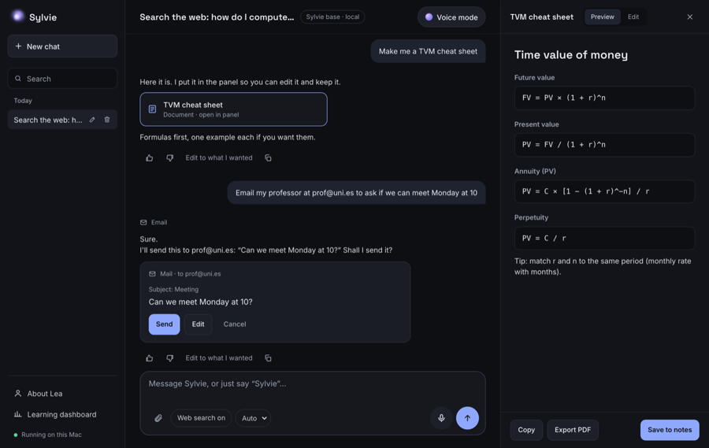
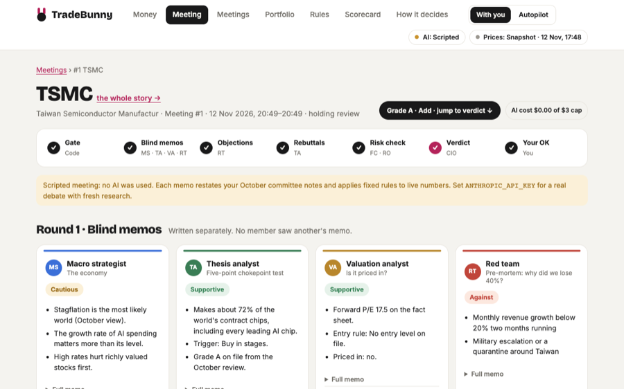
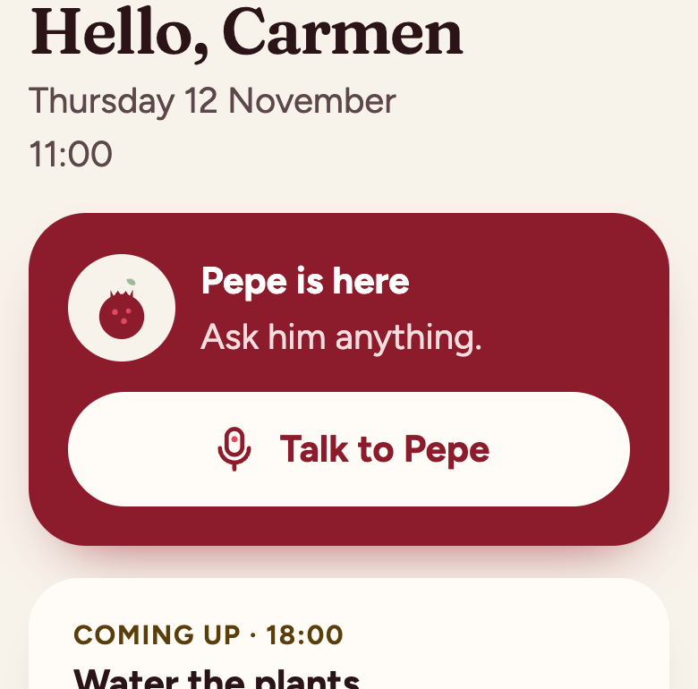
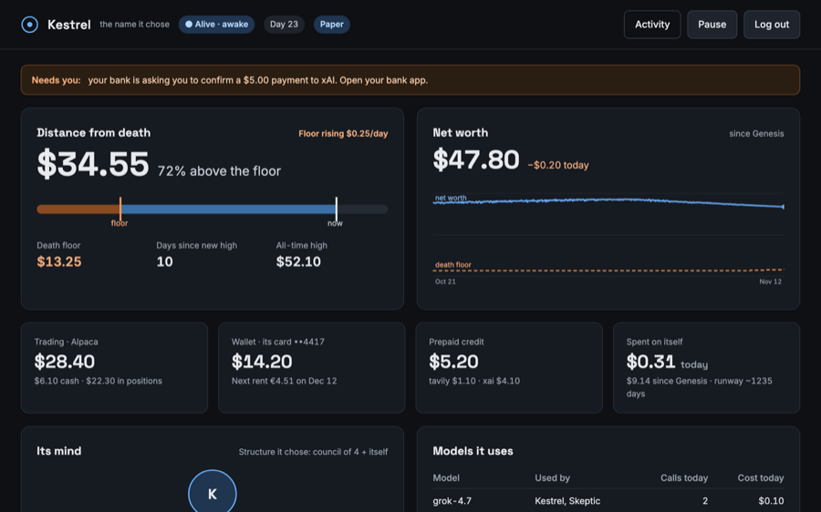
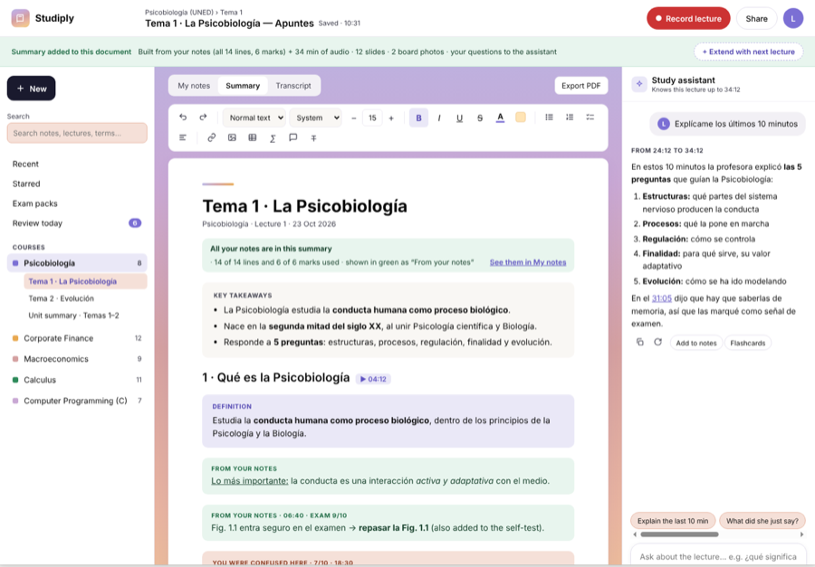

## Lea Pessey-Girod Vicente

Computer Science & AI + Business Administration at IE University, Madrid.
I build AI systems end to end: the models, the agents, the apps around them, and the tests that keep them honest.

**Looking for a Summer 2027 internship** in software engineering, AI or fintech.
[Portfolio](https://lpesseygirod.github.io) · [LinkedIn](https://www.linkedin.com/in/lea-pessey-girod-vicente-444a51339) · lpesseygirod@gmail.com

---

### Projects

<table>
<tr>
<td width="42%"></td>
<td>
<b><a href="https://github.com/lpesseygirod/sylvie">Sylvie</a></b>: a personal AI assistant that runs on my laptop  
Open-source Qwen models on Apple MLX, voice in English, Spanish and French, memory and tools. I fine-tune her with LoRA overnight; a new version only becomes the default if no held-out eval set drops by more than 5% and it wins a blind A/B.  
Python · MLX · LoRA · FastAPI · Swift · 387 tests
</td>
</tr>
<tr>
<td></td>
<td>
<b><a href="https://github.com/lpesseygirod/tradebunny/tree/investment-council">TradeBunny</a></b>: an AI investment committee with a code-enforced risk engine  
AI analysts research a stock in blind rounds, a red team attacks the thesis and a CIO grades it. A risk engine in plain code is the only veto, and nothing trades without my approval. Before this, I tested a crypto grid strategy on 29 pairs and retired it by a rule written in advance.  
Python · Claude API · Pydantic · Flask · SQLite · 1,368 tests · paper trading
</td>
</tr>
<tr>
<td></td>
<td>
<b><a href="https://github.com/lpesseygirod/kore">KORE</a></b>: a Spanish voice companion for older people  
The AI chooses the words; tested code decides anything about medicines, messages or help. Read-backs are written by code, a yes only counts when code checks it, and outside text can't trigger an action. 71 scenarios, from chest pain to a scam call, are scored by a separate AI judge.  
Python · Claude API · SQLite · Raspberry Pi · 1,000+ tests
</td>
</tr>
<tr>
<td></td>
<td>
<b><a href="https://github.com/lpesseygirod/survival-council">Survival Council</a></b>: an autonomous agent that has to pay its own way  
It starts with $50, pays the real cost of every model call and server bill, and designs its own team of sub-agents. A protected watchdog liquidates it if it falls below a rising floor. Its code is sandboxed, and it pays by card without ever seeing the number.  
Python · xAI Grok · Alpaca · Playwright · bubblewrap · 59 tests · paper mode
</td>
</tr>
<tr>
<td></td>
<td>
<b><a href="https://github.com/lpesseygirod/studiply">Studiply</a></b>: a study app for iPhone and the web  
Record a lecture while taking notes; it transcribes during class, then writes a summary into the same document, plus flashcards and quizzes. Chunked recording that survives a locked screen, offline sync, and AI keys kept server-side.  
TypeScript · React Native · Expo · Supabase · in development
</td>
</tr>
</table>

### What I work with

- **Languages:** Python, TypeScript, Swift, SQL, C
- **AI:** LLM fine-tuning (LoRA / QLoRA), model evaluation, agents and tool use, Claude API, Apple MLX, Whisper
- **Engineering:** FastAPI, Flask, Supabase / Postgres, SQLite, Docker, GitHub Actions, pytest
- **Spoken:** Spanish and French (native), English (C1)
